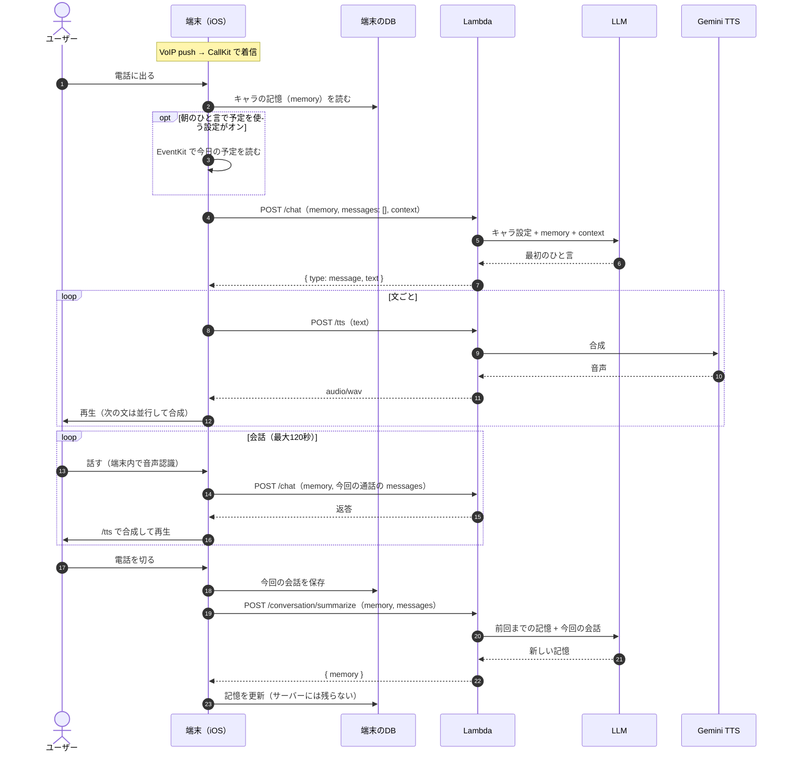
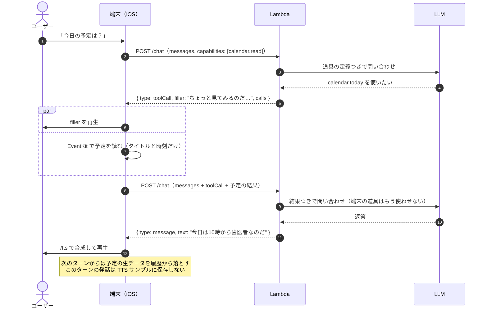
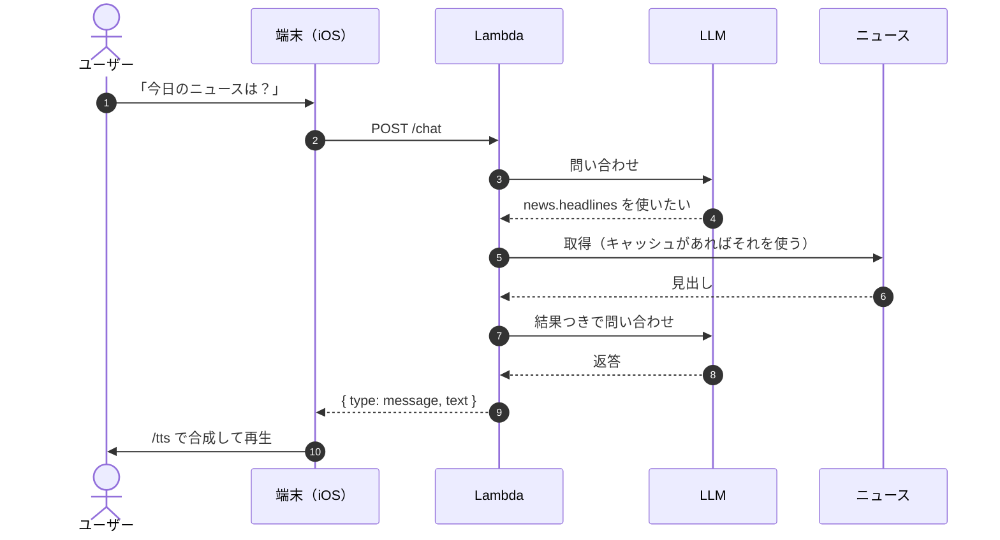
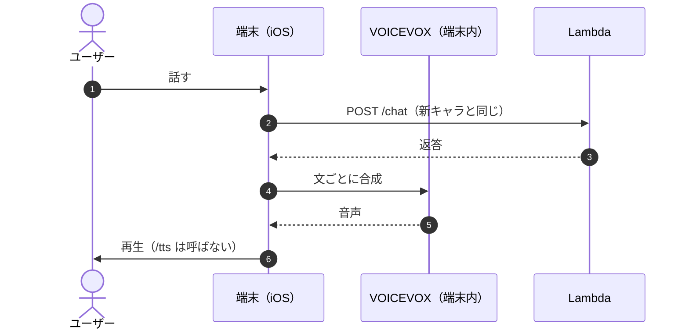

# 会話 API 設計（5.0.0）

5.0.0 の会話機能（新しい3Dキャラとの会話、カレンダー連携、Gemini TTS）を支える API の設計。
2026-10-11 時点の方針で、実装しながら更新する。

関連 issue: #245（Gemini TTS の PoC）、#261（API の乱用対策）、#262（ずんだもんの統合）

## 方針

- **会話の頭脳（LLM と道具の制御）は Lambda に置く。** プロンプト、モデル、道具を、アプリのリリースなしで変えられるようにする。
- **端末は「手元のデータを集める役」と「記憶を持つ役」にする。** カレンダーは端末で読む（EventKit）。
- **サーバーは会話データを保存しない。** 会話の履歴も要約（長期の記憶）も、端末のローカル DB に置く。
- **音声合成はキャラごとに切り替える。** 新キャラは Gemini TTS（Lambda 経由）、ずんだもんは VOICEVOX（端末内）。

```
                会話の頭脳（Lambda）
  端末 ── /chat ──→ LLM（function calling）──→ サーバーの道具（ニュース・天気）
   ↑ │                 │
   │ └─ 端末の道具（カレンダー）を頼み返されたら、端末で実行して再送
   │
   ├─ /tts ──→ Gemini TTS（新キャラ）
   └─ VOICEVOX（ずんだもん、端末内）
```

## 会話の流れの例

### 1. アラームで着信してから終話まで（全体）



### 2. 「今日の予定は？」（端末の道具を頼み返す）



### 3. 「今日のニュースは？」（サーバーの道具は往復が増えない）



### 4. ずんだもんの場合（音声合成だけ端末内）



## データの方針

| データ | 置き場所 | 備考 |
|---|---|---|
| 会話の履歴 | 端末（SwiftData） | サーバーには保存しない |
| キャラごとの記憶（要約） | 端末（SwiftData） | 毎回 `/chat` に送る。機種変更で消える（必要になれば CloudKit 同期を検討） |
| 予定（カレンダー） | 端末 | 要るときだけ送る。送るのはタイトルと時刻だけ |
| TTS の発話テキストと音声 | S3（非公開） | 品質の評価・分析用。userID と紐づけない。下の「TTS サンプルの保存」を参照 |
| 利用量（回数・音声の秒数） | DynamoDB | キャラ別の集計（売上の分配）と回数制限に使う |

- Lambda のログに会話の本文を出さない。
- LLM と TTS の事業者（OpenAI、Google）には会話の内容が送られる。プライバシーポリシーに書く。

## エンドポイント

認証は既存の Basic 認証（`userID:authToken`）。

### `POST /chat`（既存を拡張）

**リクエスト**

```json
{
  "charaID": "com.charalarm.xxx",
  "memory": "ユーザーは朝が苦手。呼び方は「たこさん」。先週は引っ越しの話をした。",
  "messages": [
    { "role": "user", "content": "今日の予定は？" }
  ],
  "capabilities": ["calendar.read"],
  "context": {
    "now": "2026-10-11T07:00:00+09:00",
    "timeZone": "Asia/Tokyo"
  }
}
```

- `memory`：端末に保存してあるキャラごとの記憶。
- `messages`：**今回の通話の履歴だけ**。過去の通話は `memory` に要約済み。
- `messages` の `role` は `system`・`user`・`assistant`。`system` は「電話に出た」「会話を終える」のような場面の指示に使う（場面は呼び出し側が知っている）。
- `capabilities`：端末で使える道具。カレンダーの許可がない場合は `calendar.read` を含めない。LLM はそれを前提に話す。
- 端末は毎回すべてを送る。サーバーは状態を持たない。

**レスポンス（返答）**

```json
{ "type": "message", "text": "今日は10時から歯医者、15時から会議なのだ。" }
```

**レスポンス（端末の道具を頼み返す）**

```json
{
  "type": "toolCall",
  "filler": "ちょっと見てみるのだ…",
  "calls": [
    { "id": "call_1", "name": "calendar.today", "arguments": {} }
  ]
}
```

端末は `filler` を再生している間に道具を実行し、結果を `messages` に足して `/chat` を呼び直す。

```json
{
  "messages": [
    { "role": "user", "content": "今日の予定は？" },
    { "role": "assistant", "toolCalls": [ { "id": "call_1", "name": "calendar.today", "arguments": {} } ] },
    { "role": "tool", "toolCallID": "call_1", "content": "[{\"title\":\"歯医者\",\"start\":\"10:00\",\"end\":\"11:00\"}]" }
  ]
}
```

### `POST /tts`（新規）

**リクエスト**

```json
{ "charaID": "com.charalarm.xxx", "text": "今日は10時から歯医者なのだ。" }
```

**レスポンス**：`200 Content-Type: audio/wav`（音声そのもの）

- 声（voice、モデル、style）はサーバー側のキャラ設定で決める。端末からは指定しない。
- 端末は文ごとに区切って呼び（既存の `TextChunker`）、1文目を再生している間に2文目を合成する。
- ずんだもん（VOICEVOX）のキャラでは呼ばない。

### `POST /conversation/summarize`（新規）

**リクエスト**：`charaID`、`memory`（前回までの記憶）、`messages`（今回の通話）

**レスポンス**

```json
{ "memory": "ユーザーは朝が苦手。呼び方は「たこさん」。今日は歯医者の予定があった。" }
```

- 通話が終わった後に、端末が裏で呼ぶ。ユーザーを待たせない。
- サーバーは何も保存しない。返ってきた記憶は端末が保存する。
- 記憶は「呼び方・好み・前に話したこと」のような項目を決めた形にする。キャラの口調に引っ張られにくくするため。
- 予定の生データは記憶に入れない。

## キャラごとの会話の設定

会話の設定はキャラ情報（chara-table）に持ち、キャラを切り替えると通話の中身も変わる。

| 項目（chara-table） | 中身 | `/chara` で端末に返すか |
|---|---|---|
| `conversationPrompt` | キャラの人格プロンプト。空でなければ会話に対応する | 返さない（サーバが `/chat` で付ける） |
| `voiceProvider` | `voicevox`（端末内で合成）か `gemini`（`/tts` で合成）。空なら `voicevox` | 返す |
| `voicevoxStyleID` | VOICEVOX のスタイル ID | 返す |
| `geminiVoice` / `geminiVoiceStyle` | Gemini TTS の声と話し方。空ならサーバの既定 | 返さない（サーバが `/tts` で使う） |
| `callOpeningPrompt` / `callEndingPrompt` / `callNoInputEndingPrompt` | 通話の最初・2分経過・無音のときの指示。空ならサーバの既定 | 返す |

- `/chara` のレスポンスでは、会話に対応するキャラだけが `conversation` を持つ。
- 端末は `conversation` の場面のプロンプトを `system` として `/chat` に送る（場面は呼び出し側が知っている）。
- `/tts` は `voiceProvider` が `gemini` のキャラだけ合成する。
- 管理画面の更新 API は、送られなかった項目を変えない（管理画面がまだ送らない項目を、保存のたびに空で消さないため）。

## エージェントと道具

返答を作る LLM が function calling で道具を選ぶ。ルーター用の別モデルは置かない（1段増えるだけ遅くなるため）。

| 道具 | 実行する場所 | 往復 |
|---|---|---|
| `calendar.today` など | 端末（EventKit） | `/chat` が1往復増える |
| ニュース、天気 | Lambda | 増えない（Lambda の中で完結） |

**往復の上限**

- 1ターンで端末に頼み返すのは**1回まで**。端末の道具が複数要るときは、1回の `toolCall` にまとめる。
- 2回目の `/chat` で LLM がまた端末の道具を使おうとしても許さず、手元の情報で返答させる。
- これで、どんな質問でも `/chat` は**最大2往復**になる。
- サーバーの道具を含めた Lambda の中のループも、最大3回までにする。

**アラームの最初のひと言**

朝の電話では「今日は○○だね」と自分から言わせたい。設定でオンにした人だけ、最初の `/chat` に今日の予定を先に入れて送る。予定が毎朝自動で送られるので、同意を取ってからにする。

## 予定（センシティブな情報）の扱い

- 予定は、エージェントが「要る」と判断したときだけ読む。
- 送るのはタイトルと時刻だけ。場所・参加者・メモは送らない。
- 道具の結果を使ってキャラが返答したら、次のターン以降の履歴からは予定の生データを落とす。
- 道具の結果を使ったターンの発話は、TTS サンプルとして保存しない。
- 将来の候補：使うカレンダーを選べるようにする、タイトルを隠すモード。

## 入力の上限

端末が送る値は書き換えられる前提で扱う。費用を膨らませる乱用を防ぐため、サーバーで上限をかけ、超えたら `400` を返す。

| 項目 | 上限 |
|---|---|
| `memory` | 1,000 字 |
| `messages` | 30 件、1件 500 字（120秒の通話で最大24件ほどになるため） |
| `/tts` の `text` | 200 字（文ごとに呼ぶ前提） |

回数制限（#261）は別に考える。

## プロンプトの組み立て

OpenAI のプロンプトキャッシュ（先頭が同じなら自動でキャッシュ）が効くよう、変わりにくい順に並べる。

```
システムプロンプト（キャラ設定） → 道具の定義 → memory → context → messages
```

## モデルと費用

- 会話：**Vertex AI の `gemini-3.1-flash-lite`**（思考は `MINIMAL`。入力 $0.25、出力 $1.50 / 100万トークン）。2026-10-11 に決定。
  - 10回ずつ測った普段の返答時間は、gemini-3.1-flash-lite 1.05秒（最大 1.2秒）、GPT-6 Luna 1.0秒（最大 2〜3秒）、gpt-4o-mini 0.85秒。
  - Luna の方が約2.5倍安いが、遅くなるときの幅が小さいことと、TTS と同じ WIF で鍵なしにできること（OpenAI の API キーが要らない）を優先した。
  - staging / production は今のところ `gpt-4o-mini`。
- 要約：同じモデル。
- TTS：Gemini 3.8 Flash TTS（約 $0.0135 / 音声1分。2027-01-01 に倍額）。

**2分の通話の目安**

| 項目 | 費用 |
|---|---|
| LLM（10ターン、入力2万 + 出力1千トークン） | 約 $0.0065（1.0円） |
| TTS（キャラが1分しゃべる） | 約 $0.0135（2円） |

LLM の費用は TTS の半分程度なので、LLM は価格より返答の速さと口調で選ぶ。`llm.Client` で差し替えられる。

## Lambda から Vertex AI への認証

AWS → GCP の Workload Identity 連携を使い、SA の鍵は発行しない。

- development：sandbox（`sandbox-492513`）の `charalarm-aws` プールに、API Lambda の実行ロール `charalarm-api-role` だけを信頼させてある。借用する SA は `charalarm-tts`（`roles/aiplatform.user`）。gcp-iac#38。
- production：shared（`takoikatakotako-shared`）に同じ構成を作る。
- Lambda には credential config（`external_account` の JSON。秘密値なし）を渡し、Go は `golang.org/x/oauth2/google` で読む。

## TTS サンプルの保存

品質の評価・分析のため、`/tts` の音声とメタデータを保存する。

```
s3://charalarm-{env}-tts-samples/tts/{charaID}/{yyyy}/{mm}/{dd}/{uuid}.wav
                                                         /{uuid}.json
```

`.json` に入れるもの：テキスト、voice、モデル、style、文字数、音声の秒数、最初の音までの時間、全体の時間。**userID は入れない。**

| 項目 | 設定 |
|---|---|
| 公開 | Block Public Access を全部オン。CloudFront につながず、署名つき URL も発行しない |
| Lambda の権限 | `tts/` 配下への `s3:PutObject` だけ |
| 読む人 | 管理者の IAM（SSO）だけ |
| 暗号化 | SSE-KMS |
| 通信 | TLS 以外を拒否するバケットポリシー |
| 保存期間 | 自動削除しない。90日後に Glacier Instant Retrieval へ移す |
| 所有者 | BucketOwnerEnforced（ACL を使わない） |

**運用**

1. 個人情報を消す作業は S3 の中でやる。
2. きれいになったものだけを、任意のタイミングで管理者の Google Drive に移す。
3. 移したものは S3 から消す（Lambda には削除の権限がないので、管理者が行う）。

保存しないもの：

- 道具の結果（予定など）を使ったターンの発話
- 電話番号やメールアドレスのような個人情報を検出したもの

**用途の制限**：保存した音声とテキストは評価・比較・分析にだけ使う。Gemini の出力で Google のモデルに似たモデルを作る・改善することは規約で禁止されている（公開しない実験でも同じ）。

## 規約上の制約（Google Cloud Service Specific Terms、2026-10-08 版）

| 条項 | 内容 | 対応 |
|---|---|---|
| 20(d) 年齢制限 | 18歳未満向け、または18歳未満が使う可能性が高いアプリで生成 AI を使ってはいけない（Charalarm は 9+） | **利用規約に「会話機能は18歳以上」と書く**（2026-10-11 決定）。規約だけでは弱いので、必要になったら自己申告の年齢確認と Apple の Declared Age Range API を足す |
| 5(d) Pre-GA | Preview 版には DPA が適用されず、個人データを処理すべきでない（"should not"） | Gemini 3.8 Flash TTS は Preview。予定を使ったターンも TTS を通るので、GA の時期を見ながら判断する |
| 17(b) | 出力で Google のモデルに似たモデルを作る・改善することは禁止 | TTS サンプルは評価・分析だけに使う |

Gemini API（AI Studio）にも同じ年齢制限があるので、乗り換えても解決しない。

## リリース前に決めること

- [ ] 利用規約とプライバシーポリシーの更新（18歳以上、LLM と TTS の事業者への送信、TTS サンプルの保存）
- [ ] Gemini TTS の GA の時期と、Preview のまま出すか
- [ ] 朝のひと言で予定を先に送る設定（同意の取り方）
- [ ] 会話と要約のモデル（Luna を公式の価格と品質で確認）
- [ ] production の WIF（shared）と TTS サンプル用のバケット

## 後で考えること

- `/tts` のストリーミング（最初の音まで約0.6秒になる。Go の Lambda では Lambda Web Adapter が必要）
- 音声の圧縮（AAC など）
- 決まったセリフの事前生成とキャッシュ
- 端末が先に判断して、最初の `/chat` に予定をつける方法（1往復で済む）
