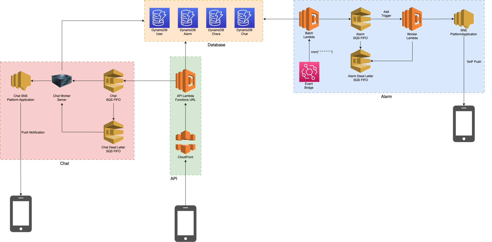
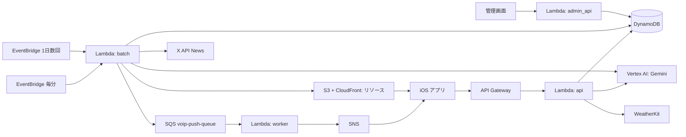
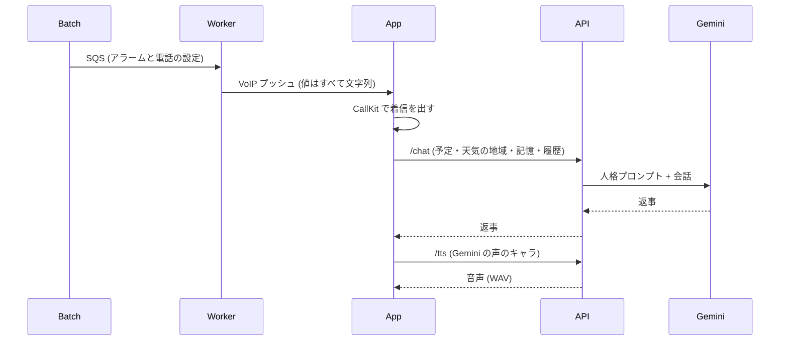

# システム

Charalarm のサーバは AWS のサーバーレスで動いています。会話の AI と音声合成は Google Cloud の Vertex AI (Gemini) を使います。

!!! note
    図は古い構成のままです (天気・ニュース・Gemini が入っていません)。下の説明が今の構成です。

Lambda はすべてコンテナイメージです。イメージは management アカウントの ECR に置き、各環境の Lambda がそれを使います。
API と admin_api は Lambda Web Adapter で Echo をそのまま動かしています。

## API (application/api)

API Gateway + Lambda + DynamoDB。アプリからのリクエストを受けます。エンドポイントは [API エンドポイント](../development/api-endpoint.md)。

- ユーザー・アラーム・キャラ・お知らせの読み書き
- `/chat`: キャラとの会話。人格プロンプトをサーバで付け、Gemini に投げて返事を返す (同期)。電話の最初のひとことでは、端末から来た今日の予定・天気の地域を使い、天気は WeatherKit REST から取る (地域ごとに 1 時間キャッシュ)
- `/tts`: キャラの声で読み上げた音声 (WAV) を返す (Gemini TTS)
- `/chat` と `/tts` は usage-table で 1 日の回数を数え、超えたら 429

## Batch (application/batch)

EventBridge + Lambda。入力の `job` で仕事を分けます。

- **毎分 (job なし)**: alarm-table から今の時刻 (UTC) のアラームを引き、SQS に 1 件ずつ入れる
- **話題のニュース (`{"job":"trendNews"}`)**: X API の News 検索で話題を取り、Gemini で子ども (9+) が朝に聞いてよいものを選んで、日本語・英語の両方の文を作る。S3 のリソースに `trend-news/ja.json`・`trend-news/en.json` として置き、アプリはそれを使い回す。development は 1 日 1 回

## Worker (application/worker)

SQS + Lambda + SNS。SQS からメッセージを受け取り、SNS で VoIP プッシュを送ります。中身は [SQS](../development/sqs.md)。

## 電話 (着信から会話まで)

- 会話の履歴・キャラの記憶・予定の中身は端末にだけ置き、サーバには保存しない (ログにも出さない)
- VOICEVOX のキャラ (ずんだもん) は端末で音声を合成する
- VRM のキャラは WKWebView (three-vrm) で表示する

## 管理画面 (admin, application/admin_api)

Next.js の静的エクスポートを S3 + CloudFront で配り、API は Lambda Function URL を CloudFront 配下に置いています。
キャラ・タップのセリフ・お知らせの編集と、ユーザー・アラームの確認ができます。

## 秘密の値

API キーなどは SSM パラメータストアに置き、Lambda の環境変数に `ssm://<パラメータ名>` と書くと起動時に読みます (`application/environment`)。
例: WeatherKit の秘密鍵 `/charalarm/<env>/weatherkit-private-key`、X の Bearer Token `/charalarm/<env>/x-api-bearer-token`。
GCP へは Workload Identity Federation で入ります (GCP 側の設定は別リポジトリ gcp-iac)。
